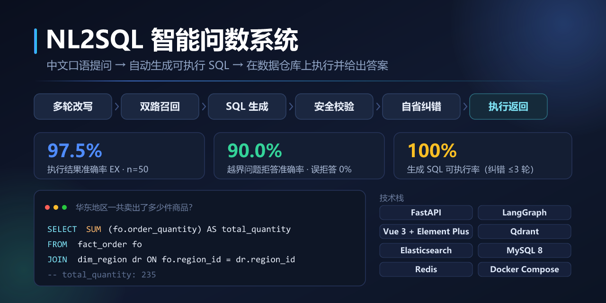
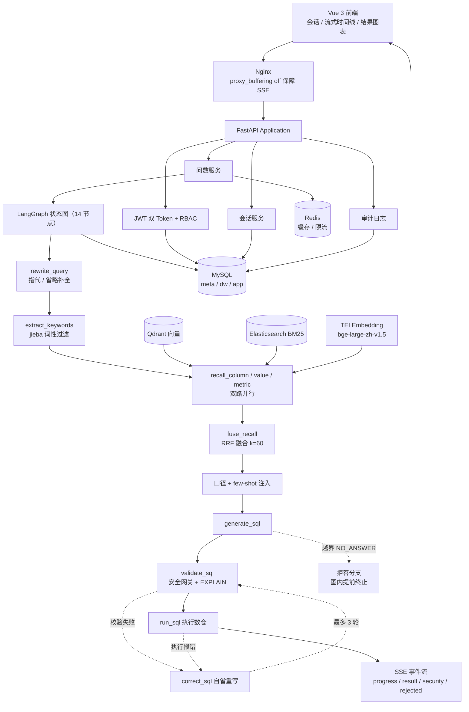

# NL2SQL 智能问数系统

NL2SQL 智能问数系统是一个面向企业经营分析场景的全栈 Text-to-SQL 智能体，后端基于 FastAPI、LangGraph、MySQL、Qdrant 和 Elasticsearch，前端基于 Vue 3、Element Plus 和 ECharts。用户用中文口语提问，系统经多轮改写、混合检索、SQL 生成与自省纠错后在数据仓库上执行并返回结果，全程通过 SSE 流式可见。

项目从"能否写对 SQL"出发，补齐了多轮指代理解、混合召回融合、指标口径注入、SQL 安全网关、自省纠错闭环、数据范围边界拒答、多用户隔离、限流缓存、审计追踪和可复现评测体系等落地能力。

本项目定位不是 Prompt 调用 Demo，而是一个有明确评测证据、有清晰边界意识、可继续扩展为企业内部问数助手的工程化 MVP。




---

## 项目亮点

- **14 节点 LangGraph 问数 Agent**：以查询改写为入口，串联关键词抽取、双路召回、RRF 融合、指标口径与 few-shot 注入、SQL 生成与安全校验、自省纠错闭环，每个节点独立推送 SSE 进度。
- **多轮指代与省略理解**：`rewrite_query` 作为状态图 START，结合历史把"那华南呢？"补全为可独立理解的问题，异常时回退原问题而不中断整图。
- **混合召回 + RRF 融合**：Qdrant 向量召回（bge-large-zh）与 Elasticsearch BM25 关键词召回并行，按 `score = Σ 1/(k + rank)`（k=60）融合，缓解口语问法与库表字段名不一致的问题。
- **指标口径注入**：GMV、AOV 等经营指标的计算口径作为元数据持久化，在生成 SQL 前注入上下文，避免模型按字面臆造聚合方式。
- **自省纠错闭环**：把静态校验失败、EXPLAIN 预检失败和数据库执行报错回喂模型重写 SQL，最多 3 轮，平均 2.0 次收敛。
- **SQL 安全网关**：只读策略、危险子句拦截、自动追加行数上限，叠加数据库侧 EXPLAIN 预检与超时 / 字节限制。
- **数据范围边界与拒答**：以 `NO_ANSWER` 协议标记替代模糊 Prompt 约束，在图中 4 组条件路由上越界即终止，并输出面向用户的可读引导话术，而不是硬编一条 SQL。
- **多用户隔离**：无状态 JWT 双 Token + RBAC，会话与历史消息按用户归属校验，避免越权读取他人对话。
- **可复现评测体系**：自建 50 条分层 Golden Set 与 8 条多轮指代集，实现 EX / EM / 拒答准确率、实体级 Recall@K、七子句组件级 F1 五类指标与 5 组消融实验。
- **工程化交付**：9 服务 Docker Compose 一键启动，所有连接与 LLM 通道环境变量化，切换模型零代码改动、无需重建镜像；Redis 缓存不可用时降级进程内 TTL。

---

## 功能模块

| 模块 | 说明 |
| --- | --- |
| 自然语言问数 | 中文口语提问 → 生成 SQL → 执行 → 返回结构化结果与图表数据 |
| 多轮会话 | 会话列表、新建、重命名、删除，历史消息按归属隔离，作为改写与生成的上下文 |
| 查询改写 | 指代消解、省略补全；无历史时直接返回原问题，不做无谓的 LLM 调用 |
| 混合召回 | Qdrant 向量召回 + Elasticsearch BM25 并行，RRF 融合（k=60） |
| 指标口径 | 指标定义检索与口径注入，按字符预算分档裁剪上下文（口径 > few-shot > 召回明细） |
| SQL 生成 | 结合表结构、召回明细、口径与示例生成 SQL；可选开启自洽投票 |
| 安全网关 | 静态规则校验 + EXPLAIN 预检 + 行数 / 超时 / 字节限制 |
| 自省纠错 | 校验或执行报错回喂模型重写，最多 3 轮并保留 error_history |
| 边界拒答 | 越界问题返回可读引导话术，图内提前终止，不执行任何 SQL |
| 流式输出 | SSE 推送 `progress` / `result` / `security` / `rejected` / `error` 等事件 |
| 认证授权 | 注册、登录、refresh token、角色区分（user / admin） |
| 限流与缓存 | Redis 滑动窗口限流（认证按 IP 防爆破）与查询缓存，缓存不可用时降级进程内 TTL |
| 审计与追踪 | 审计日志落库、全链路 `request_id` 回写响应头、统一错误码体系 |
| 元数据构建 | 从元数据库与数仓抽取表 / 字段 / 取值 / 指标，写入 Qdrant 与 Elasticsearch |
| 评测与消融 | Golden Set 评测、多轮评测、组件级 F1、Recall@K、5 组消融与图表渲染 |

---

## 技术栈

| 层级 | 技术 |
| --- | --- |
| 前端 | Vue 3.5、Element Plus、Apache ECharts、Vite 7、Vue Router、Pinia、Axios、xlsx |
| 后端 | FastAPI（Python 3.12）、Pydantic、Uvicorn |
| Agent 编排 | LangGraph StateGraph（14 节点 + 4 组条件边） |
| 关键词抽取 | jieba（按词性过滤，零 LLM 调用） |
| 向量检索 | Qdrant + AsyncQdrantClient |
| 关键词检索 | Elasticsearch 8 BM25 + AsyncElasticsearch |
| Embedding | HuggingFace TEI 托管 bge-large-zh-v1.5 |
| 数据库 | MySQL 8 + asyncmy（元数据库 / 数据仓库 / 应用库三库分离） |
| 缓存与限流 | Redis 7（可降级） |
| LLM | OpenAI-compatible 接口，双模型通道（主模型 / 纠错模型） |
| 配置 | OmegaConf（YAML + 环境变量插值） |
| 日志 | 结构化日志 + request_id 上下文变量 |
| 部署 | Docker、Docker Compose、Nginx（SSE 反向代理） |
| 评测 | 自研评测 / 消融脚本 + Matplotlib 渲染 |

---

## 系统架构



---

## 项目结构

```text
.
├── data-agent/                      # 后端
│   ├── app/
│   │   ├── agent/                   # LangGraph 状态图与节点实现
│   │   │   ├── graph.py             #    14 节点装配 + 条件路由（含拒答分支）
│   │   │   ├── state.py             #    图状态定义
│   │   │   ├── context_enhancer.py  #    指标口径与 few-shot 上下文增强
│   │   │   ├── self_consistency.py  #    自洽投票
│   │   │   └── nodes/               #    14 个节点（rewrite_query 为 START）
│   │   ├── api/                     # 路由、依赖注入、异常处理器、生命周期
│   │   ├── core/                    # 安全、限流、缓存、审计、错误码、拒答判定
│   │   ├── clients/                 # MySQL / Redis / Qdrant / ES / Embedding 客户端
│   │   ├── repositories/            # 数据访问层
│   │   ├── services/                # 业务服务层
│   │   ├── models/                  # ORM 模型（user / conversation / message / audit_log）
│   │   ├── entities/                # 领域对象与枚举
│   │   ├── prompt/                  # 提示词模板
│   │   └── scripts/                 # 应用库初始化、元数据索引构建、依赖探活
│   ├── conf/                        # app_config.yaml / meta_config.yaml
│   ├── docker/                      # docker-compose.yaml、.env.example、Nginx 配置
│   ├── evaluation/                  # 评测集、评测报告与产物
│   ├── scripts/                     # 评测、消融、导出、自检脚本
│   ├── prompts/                     # 提示词资产
│   └── main.py
├── data-agent-fronted/              # 前端（Vue 3）
│   ├── src/
│   │   ├── views/                   # LoginView / HomeView
│   │   ├── components/              # ResultPanel（表格 + 图表 + 导出）
│   │   ├── api/                     # auth / user / conversation / sse
│   │   └── store/                   # user / conversation
│   ├── nginx.conf
│   ├── Dockerfile
│   └── vite.config.js
├── docs/                            # 架构说明、部署指南、门面图
└── README.md
```

---

## 快速开始

### 1. 准备环境

建议使用：

- Python 3.12+
- Node.js 20+
- Docker 与 Docker Compose（用于起 MySQL / Elasticsearch / Qdrant / Redis / TEI）
- MySQL 8+

**第一步：下载 Embedding 权重**（约 1.3 GB，因体积原因不在仓库内）

```bash
python -m modelscope.cli.cli download \
    --model BAAI/bge-large-zh-v1.5 \
    --local_dir data-agent/docker/embedding/bge-large-zh-v1.5
```

**第二步：只起中间件**（不起应用进程，方便本地调试后端）

```bash
cd data-agent/docker
docker compose up -d mysql elasticsearch qdrant redis embedding
```

> TEI 在 CPU 下加载该模型约需 5~6 分钟才算就绪，属正常现象。

**第三步：配置环境变量**

后端配置走 OmegaConf（YAML + 环境变量插值），本地进程启动时用环境变量覆盖即可：

```bash
export DB_HOST=localhost DB_PORT=3307
export ES_HOST=localhost ES_PORT=9200
export QDRANT_HOST=localhost QDRANT_PORT=6333
export EMBEDDING_HOST=localhost EMBEDDING_PORT=8081
export REDIS_HOST=localhost REDIS_PORT=6379
export APP_JWT_SECRET_KEY=your-dev-secret-key
# LLM 通道（OpenAI-compatible 协议，可替换为任意兼容服务）
export LLM_BASE_URL=https://api.deepseek.com/v1
export LLM_API_KEY=your-api-key
export LLM_MODEL_NAME=deepseek-chat
export LLM_MODEL_NAME_CODE=deepseek-chat
```

### 2. 初始化数据

```bash
cd data-agent
uv sync
python -m app.scripts.init_app_db                                     # 建应用库表（user / conversation / message / audit_log）
python -m app.scripts.build_meta_knowledge -c conf/meta_config.yaml   # 从元数据与数仓抽取知识，写入 Qdrant 与 ES
```

> 注意：必须写成 `python -m app.scripts.xxx`；写成 `python app/scripts/xxx.py` 会因找不到 `app` 包而失败。

### 3. 启动后端

```bash
uv run uvicorn main:app --reload --host 0.0.0.0 --port 8000
```

后端地址：

- Swagger：`http://127.0.0.1:8000/docs`
- ReDoc：`http://127.0.0.1:8000/redoc`

系统没有预置账号，先调注册接口创建，再登录：

```bash
curl -X POST http://127.0.0.1:8000/api/auth/register \
  -H 'Content-Type: application/json' \
  -d '{"username":"demo","password":"demo123456"}'
```

> 注册账号默认为 `user` 角色。`/api/admin/*` 接口需要 `admin` 角色，可将相应用户在 `user` 表中的 `role` 字段置为 `admin`。

### 4. 启动前端

```bash
cd data-agent-fronted
npm install
npm run dev
```

前端地址：

```text
http://127.0.0.1:5173
```

Vite 开发环境会把 `/api` 代理到后端，可通过环境变量修改代理目标：

```text
VITE_API_TARGET=http://127.0.0.1:8000
```

---

## Docker 启动

容器启动（后端 + 前端 + 中间件，共 9 个服务）：

```bash
cd data-agent/docker
cp .env.example .env
docker compose up -d --build
```

启动前请在 `.env` 中至少修改：

- `MYSQL_ROOT_PASSWORD`、`MYSQL_PASSWORD`
- `APP_JWT_SECRET_KEY`（生成方式：`openssl rand -hex 32`）
- `LLM_API_KEY`、`LLM_BASE_URL`、`LLM_MODEL_NAME`、`LLM_MODEL_NAME_CODE`

| 服务 | 地址 |
| --- | --- |
| 前端（Nginx） | `http://localhost:8080` |
| 后端 API | `http://localhost:8000/docs` |
| MySQL（宿主映射 3307） | `localhost:3307` |
| Elasticsearch | `http://localhost:9200` |
| Kibana | `http://localhost:5601` |
| Qdrant | `http://localhost:6333` |
| TEI Embedding | `http://localhost:8081` |
| Redis | `localhost:6379` |

编排说明见 [docs/deployment.md](docs/deployment.md)，其中记录了启动顺序、依赖探活与常见问题（例如 Nginx 必须关闭 `proxy_buffering` 与 gzip，否则 SSE 会被缓冲成一次性返回）。

---

## 前端页面

前端采用单页 + 弹层的形态，核心交互集中在首页：

| 路由 | 页面 | 访问条件 |
| --- | --- | --- |
| `/login` | 登录 / 注册 | 未登录；已登录访问会自动回首页 |
| `/` | 问数工作台 | 登录后（路由守卫校验 token） |

首页内部包含：

- **会话侧栏**：新建、切换、重命名、删除会话，刷新后按服务端归属恢复。
- **流式时间线**：逐节点展示进度（召回 → 融合 → 生成 → 校验 → 执行），让用户知道系统在做什么，而不是干等。
- **结果面板**：表格与图表双视图（ECharts），支持导出；命中缓存时标记来源。
- **拒答提示**：越界问题以可读话术呈现，而不是报错或给出一条错误的 SQL。

---

## 主要 API

### 问数

| Method | Path | 说明 |
| --- | --- | --- |
| POST | `/api/query` | 发起一次问数，返回 SSE 事件流 |

SSE 事件类型：

| type | 含义 |
| --- | --- |
| `progress` | 节点执行进度 |
| `result` | SQL 与查询结果集 |
| `security` | 触发安全网关拦截 |
| `rejected` | 超出数据范围，走拒答分支 |
| `self_consistency` | 自洽投票过程（开启时） |
| `meta` | 会话与问题元数据 |
| `error` | 处理异常 |

### 认证授权

| Method | Path | 说明 |
| --- | --- | --- |
| POST | `/api/auth/register` | 注册账号（默认 `user` 角色） |
| POST | `/api/auth/login` | 登录，返回 access token 与 refresh token |
| POST | `/api/auth/refresh` | 刷新 access token |
| GET | `/api/users/me` | 当前用户信息 |

### 会话

| Method | Path | 说明 |
| --- | --- | --- |
| GET | `/api/conversations` | 当前用户会话列表（分页） |
| POST | `/api/conversations` | 新建会话 |
| GET | `/api/conversations/{conversation_id}/messages` | 某会话的历史消息（校验归属） |
| PATCH | `/api/conversations/{conversation_id}` | 重命名会话 |
| DELETE | `/api/conversations/{conversation_id}` | 删除会话（级联删除消息） |

### 管理与运维

| Method | Path | 说明 |
| --- | --- | --- |
| GET | `/api/admin/audit-logs` | 查询审计日志（仅 admin，支持用户 / 时间范围 / 状态筛选与分页） |
| POST | `/api/admin/cache/clear` | 清空查询缓存 |

> 统一响应体为 `ApiResponse`；业务错误码（如 `40101` 未授权、`40301` 无权限、`42900` 限流）与 HTTP 状态码解耦，便于前端分场景处理。
> 所有请求均回写 `X-Request-ID` 响应头，可与日志对齐排查。

---

## 评测与消融

评测不依赖 HTTP 接口，直接调用编译后的 LangGraph，保证可复现。

```bash
cd data-agent

# 主评测：50 条分层 Golden Set（业务类 40 + 越界类 10）
python scripts/run_evaluation.py --limit 50

# 消融实验：5 组配置逐项叠加
python scripts/run_ablation.py

# 多轮改写专项：8 条指代 / 省略集
python scripts/run_ablation.py --multi-turn
```

当前结果：

| 指标 | 结果 |
| --- | --- |
| EX 执行准确率 | 97.5% |
| SQL 有效率 | 100% |
| 拒答准确率 / 误拒答率 | 90% / 0% |
| 表 / 字段 / 指标 召回率 @10 | 100% / 85.8% / 100% |
| 组件级综合 F1（7 子句） | 90.4 |
| 多轮改写专项（开启 vs 关闭） | 87.5% vs 37.5% |

5 组消融（逐项叠加配置）：

| 配置 | EX | 字段召回 @10 | 组件级 F1 |
| --- | --- | --- | --- |
| G1 baseline | 95.0% | 84.4% | 86.1 |
| G2 +RRF 融合 | 95.0% | 87.2% | 84.8 |
| G3 +自省纠错 | 92.5% | 85.6% | 82.9 |
| G4 +口径 & few-shot | 95.0% | 87.4% | 86.5 |
| G5 full（含自洽投票） | 100.0% | 89.6% | 92.9 |

评测集与产物在 `data-agent/evaluation/`，报告见 `report.md` 与 `ablation.md`。

---

## 已知局限与后续方向

诚实标注边界，是这个项目的一部分：

- **评测集规模**：50 条自建题目，样本量偏小，结论应限定在本数仓结构与本题集范围内。为此额外引入了实体级 Recall@K 与七子句组件级 F1，把每条样本的判定点从 1 个扩到 7 个以上，用分辨率弥补样本量。
- **元数据口径**：当前数仓仅沉淀 2 个经营指标（GMV / AOV），且其定义与自然直觉一致，因此"口径注入"在本评测集上的区分空间有限。
- **拒答存在漏拒**：拒答准确率 90%，剩余 10% 为漏拒（越界问题仍生成了 SQL），误拒答为 0%。设计上优先保证不误伤业务问题。
- **数字与模型绑定**：切换 LLM 只需改环境变量，指标会随之变化，引用这些数字时应注明所用模型与配置。

可继续增强的方向：

- 扩充 Golden Set 至 200+ 条，覆盖跨库与多事实表场景。
- 拒答分支增加相近问题推荐，而不是仅给出文本引导。
- 引入异步任务队列承载长耗时问数，支持中断、排队与结果复用。
- 增加结果解读与归因能力（例如"同比大跌主要由哪个字段贡献"）。
- 补充健康检查、Prometheus metrics 与分布式追踪，完善可观测性。
- 补充 pytest 单测与接口契约测试——目前质量保障主要依靠评测集与自检脚本。

---

## 文档

| 文档 | 内容 |
| --- | --- |
| [`data-agent/README.md`](data-agent/README.md) | **主文档**：能力清单、14 节点详解、评测与消融完整数据、复现步骤 |
| [`docs/architecture.md`](docs/architecture.md) | 架构详解：14 节点、自省闭环、拒答机制、SSE 协议、设计权衡 |
| [`docs/deployment.md`](docs/deployment.md) | Docker 部署、启动顺序、常见问题与验收记录 |

## License

[MIT](LICENSE)
