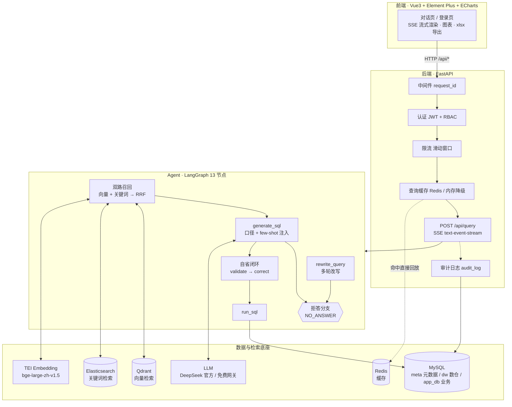
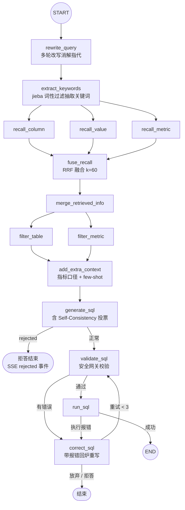

# NL2SQL 智能问数系统

> 一个把"中文口语提问"变成"可执行 SQL + 结果"的 Text-to-SQL 智能体产品原型。

> 面向电商经营场景的 **Text-to-SQL 智能问数系统**：用中文口语提问，系统自动完成
> **多轮改写 → 混合召回 → SQL 生成 → 安全校验 → 自省纠错 → 执行返回**，全程 SSE 流式可见。
>
> 后端 FastAPI + LangGraph 13 节点状态图，前端 Vue3 + Element Plus，全栈 Docker Compose 一键启动。


---

## 一、这个系统解决什么问题

BI 看板做不到的，是"临时起意的一句追问"。本项目把这类追问做成对话：

```
👤 华东地区一共卖出了多少件商品？
🤖 正在改写问题 → 检索数仓元数据 → 命中指标/字段 → 生成 SQL → 校验 → 执行
    SELECT SUM(order_quantity) AS total_quantity
    FROM fact_order fo JOIN dim_region dr ON fo.region_id = dr.region_id
    WHERE dr.region_name = '华东'
   📊 total_quantity: 235

👤 那华南呢？                     ← 指代消解，自动补全为"华南地区一共卖出了多少件商品"
👤 预测一下下个月能卖多少钱        ← 超出数据范围，明确拒答而不是编造 SQL
🤖 该问题超出了当前的数据范围，暂时无法回答……
```

三个真实难点，也是本项目的重点设计：

| 难点 | 做法 |
|---|---|
| 口语问法 ≠ 库表字段名（"卖了多少" → `SUM(order_amount)`） | 向量 + 关键词**双路召回 + RRF 融合**检索元数据，再注入指标口径与 few-shot |
| LLM 生成的 SQL 经常跑不通 | **自省纠错闭环**：`validate → correct → re-validate`，最多 3 轮 |
| 问了数仓里没有的东西，模型会一本正经地编 SQL | **数据范围边界判定**：输出 `NO_ANSWER` 标记即走拒答分支，提前结束图 |

---

## 二、已完成能力清单

### Agent 链路（LangGraph 13 节点）

- **多轮查询改写**：携带历史上下文消解指代/省略，"那华南呢"自动补全为完整问题
- **关键词抽取**：jieba 按词性过滤（名词 / 地名 / 动词 / 形容词等）抽取检索关键词，**零 LLM 调用、零延迟**
- **双路召回 + RRF 融合**：Qdrant 向量路 + Elasticsearch 关键词路，`score = Σ 1/(k+rank)`，k=60
- **表 / 指标过滤**：按相关性门槛筛掉噪声候选，控制 prompt 体积
- **上下文增强**：命中指标时结构化注入**口径定义**，并按相似度注入 **few-shot 示例**（分档字符预算裁剪）
- **Self-Consistency 自洽投票**：并行采样 3 个候选 SQL 投票选优（默认关闭，消融实验 G5 开启）
- **SQL 自省纠错闭环**：校验失败 / 执行报错 → 带错误信息回炉重写，最多 3 次
- **SQL 安全网关**：关键字 / 函数 / schema 黑名单、强制 LIMIT、行数与结果字节上限、执行超时

### 数据范围边界与拒答机制

- LLM 判定越界时输出固定标记 `NO_ANSWER`，`app/core/rejection.py` 稳健识别（容忍空白、换行、Markdown 代码块包裹，且不会误判含标记的正常 SQL）
- 图中 **4 处条件边**均可因 `rejected` 提前终止（`generate_sql` / `validate_sql` / `correct_sql` 出口 + 路由函数），不浪费后续 LLM 调用
- SSE 推送 `{"type":"rejected","reason":"out_of_scope"}` + 面向用户的可读话术（说明当前覆盖的业务域并给出可问示例）
- 实测：**拒答准确率 90%、误拒答率 0%**（业务类问题从未被错误拒答）

### 工程化能力

- **多用户并发**：无状态 JWT（access 15 分钟 / refresh 7 天）+ bcrypt 密码哈希，会话与消息按 `user_id` 隔离，服务本身不保存会话态
- **统一响应与错误码体系**：全站 `{code, message, data}`，业务错误码与 HTTP 状态码**解耦**（如 `40101` 令牌无效、`40301` 权限不足、`42900` 限流），见 `app/core/error_code.py`
- **滑动窗口限流**：业务接口按 `user_id + path`，认证入口按 IP 防爆破（登录 5 次/分、注册 3 次/分）
- **查询缓存**：Redis 优先，不可用时**自动降级**进程内 TTL 缓存；仅缓存无历史单轮问题（防跨会话污染）。实测命中 **10.4s → 0.1s**
- **审计日志**：每次问数落 `audit_log`（问题 / SQL / 状态 / 耗时 / `request_id`），独立 session + 后台任务写入，失败不影响主流程
- **全链路 request_id**：中间件生成 32 位 hex，注入日志、响应头 `X-Request-ID` 与审计表，可对账
- **LLM 双通道可切换**：免费网关 ⇄ DeepSeek 官方，只改环境变量，**无需重建镜像**
- **SSE 流式**：前端逐节点显示"正在改写 / 正在检索 / 正在生成 SQL"，nginx 已放行 `proxy_buffering off`

---

## 三、系统架构

### 3.1 整体架构



### 3.2 LangGraph 状态图（13 节点，`rewrite_query` 为 START）



> 节点源码：`app/agent/nodes/`；图装配与条件路由：`app/agent/graph.py`。
> 拒答是**一等公民**：`generate_sql` 一旦判定越界即置 `rejected`，后续 3 个条件路由函数全部直连 END。

---

## 四、技术栈

| 层 | 选型 |
|---|---|
| 后端框架 | FastAPI（异步全链路）、Pydantic、Uvicorn |
| Agent 编排 | **LangGraph** StateGraph（13 节点 + 4 组条件边） |
| LLM 接入 | LangChain `ChatOpenAI`（兼容 OpenAI 协议，统一接线超时与重试） |
| ORM / 数据库 | SQLAlchemy 2.0 异步 + **asyncmy**（MySQL 驱动） |
| 向量检索 | Qdrant + **AsyncQdrantClient** |
| 关键词检索 | Elasticsearch 8 + **AsyncElasticsearch** |
| 向量模型 | bge-large-zh-v1.5，经 HuggingFace **TEI** 容器提供 HTTP 推理服务 |
| 缓存 / 限流 | **Redis**（redis-py 异步），不可用时降级进程内实现 |
| 认证 | PyJWT（access + refresh 双 token）、bcrypt |
| 配置 | OmegaConf（`${oc.env:VAR,default}` 支持环境变量覆盖） |
| 日志 | Loguru（按 request_id 打点、滚动切割） |
| 前端 | Vue3 + Vite + Pinia + Vue Router + Element Plus + ECharts + SheetJS |
| 部署 | Docker Compose（9 服务）、nginx 反代 SSE、uv 依赖管理 |

---

## 五、快速开始

### 5.1 Docker 一键启动（推荐）

> ⚠️ **Embedding 模型权重约 1.3 GB，已被 `.gitignore` 排除，不在仓库内**，首次部署前需单独下载：

```bash
cd data-agent
python -m modelscope.cli.cli download \
    --model BAAI/bge-large-zh-v1.5 \
    --local_dir docker/embedding/bge-large-zh-v1.5
```

```bash
cd data-agent/docker
cp .env.example .env          # 首次：复制模板并填好 LLM_API_KEY / APP_JWT_SECRET_KEY / 数据库密码
docker compose up -d --build
```

启动顺序由 `backend-init` 一次性容器保证：`wait_for_deps`（TCP 探活 600s）→ `init_app_db` 建业务表
→ `build_meta_knowledge` 构建元数据知识库 → 拉起 `backend` → 拉起 `frontend`。

| 服务 | 地址 |
|---|---|
| **前端入口** | http://localhost:8080 |
| 后端 API 文档 | http://localhost:8000/docs |
| Kibana | http://localhost:5601 |
| Qdrant 控制台 | http://localhost:6333/dashboard |

> ⏱ CPU 模式下 TEI 加载 1.3 GB 模型约需 **5~6 分钟**，期间 `backend-init` 会持续等待，属正常现象。

### 5.2 本地开发启动

```bash
# 1) 起依赖（mysql / es / qdrant / redis / embedding）
cd data-agent/docker && docker compose up -d mysql elasticsearch qdrant redis embedding

# 2) 初始化业务表与元数据知识库
cd data-agent
python -m app.scripts.init_app_db
python -m app.scripts.build_meta_knowledge -c conf/meta_config.yaml

# 3) 起服务
python -m uvicorn main:app --host 127.0.0.1 --port 8000
cd ../data-agent-fronted && npm install && npm run dev     # http://localhost:5173
```

### 5.3 切换 LLM 通道

只改环境变量，**零代码改动、无需重建镜像**：

| 通道 | 环境变量 |
|---|---|
| 免费公益网关（测试用） | `LLM_BASE_URL=https://api.hcnsec.cn/v1`、`LLM_MODEL_NAME=DeepSeek-V4-Flash` |
| DeepSeek 官方（正式 / 答辩用） | `LLM_BASE_URL=https://api.deepseek.com/v1`、`LLM_MODEL_NAME=deepseek-flash` |

> 详见 [`docs/LLM通道切换指南.md`](docs/LLM通道切换指南.md)。容器部署时改 `docker/.env` 后
> `docker compose up -d backend` 即可生效。
>
> **教训**：公益网关模型会不定期下架（本项目实测已连续两次被迫换模型），
> 因此 LLM 通道、数据库地址、Redis 地址全部 Env 化，换模型不再需要改代码或重建镜像。

---

## 六、评测结果

> 评测集：Golden Set **50 条**（业务类 40 + 越界类 10），按 basic / advanced / challenge 分层，
> 覆盖 8 个类别（单表聚合 / 条件筛选 / 分组排序 / 多表关联 / 指标口径 / 时间范围 / Top-N / 越界拒答）。
> 数仓规模：订单 115 笔、客户 20 人、日期覆盖 2025 Q1（90 天），星型模型 5 表。
>
> ⚠️ **数据性质**：以下为**免费网关演练数据**（`DeepSeek-V4-Flash` via 公益网关）。
> 正式论文 / 答辩数据应切 DeepSeek 官方通道重跑主评测与消融实验（见第五节）。

### 6.1 主评测（full 配置，n=50）

| 指标 | 值 |
|---|---|
| **EX 执行准确率** | **97.5%** |
| EM 精确匹配率 | 10.0% |
| SQL 有效率 | **100.0%** |
| 拒答准确率（越界类） | **90.0%** |
| 误拒答率（业务类被拒） | **0.0%** |
| 表 / 字段 / 指标 召回率 @10 | 100.0% / 85.8% / 100.0% |
| 组件级综合 F1 | 90.4 |
| 平均自省尝试次数 | 2.0 |

**组件级 F1**（把 SQL 拆成 7 个子句逐项比对，定位错误发生在哪个环节）：

| SELECT 投影 | 聚合 | WHERE | GROUP BY | ORDER BY | JOIN | LIMIT |
|---|---|---|---|---|---|---|
| 84.2 | 95.0 | 88.3 | 95.0 | 85.0 | 85.0 | 100.0 |

**分类别 EX**：单表聚合 / 条件筛选 / 分组排序 / 多表关联 / 时间范围 / Top-N 均 **100%**；
指标口径类 80%（唯一失败项：月度 GMV 的月份表达式写法差异）。

### 6.2 消融实验（逐项叠加配置）

| 实验组 | 配置 | EX | EM | 字段召回 | 组件均值 |
|---|---|---|---|---|---|
| G1 baseline | 全部优化关闭 | 95.0% | 7.5% | 84.4% | 86.1 |
| G2 +RRF | 双路召回 RRF 融合 | 95.0% | 7.5% | 87.2% | 84.8 |
| G3 +自省 | 再加 SQL 自省纠错（3 次） | 92.5% | 5.0% | 85.6% | 82.9 |
| G4 +口径&few-shot | 再加指标口径注入 + 示例注入 | 95.0% | 12.5% | 87.4% | 86.5 |
| **G5 full** | 再加 Self-Consistency 投票 | **100.0%** | **12.5%** | **89.6%** | **92.9** |

**多轮改写专项**（指代 / 省略集，n=8）：

| 状态 | EX |
|---|---|
| 改写开启（history 正常注入） | **87.5%** |
| 改写关闭（等价单轮） | **37.5%** |

> 单轮集上改写增益恒为 0（Golden Set 无历史可消解），**多轮专项才是衡量该模块的唯一有效口径**。

### 6.3 关于指标口径，必须说清的三件事

1. **EX 是用户价值指标，EM 是工程观测指标。** EM 低不代表系统差——同一查询有无数等价写法，
   EM 只衡量"是否写成与标注一模一样"。EX（执行结果等价）才是用户真正关心的。
2. **组件级 F1 比端到端 EX 分辨率高一个量级。** 每条样本贡献 7 个判定点，
   在 EX 饱和（各配置都 95~100%）时仍能分辨配置差异：baseline 86.1 → full 92.9（+6.8pp），
   变化最大的是 JOIN +18.8pp、WHERE +11.5pp。
3. **两条诚实结论**：
   - RRF 在小规模元数据（5 表 / 2 指标，每路候选 < 20 条）下相对"并集去重"增益有限（EX 持平，字段召回 +2.8pp），
     应表述为"小规模下增益有限"，而非"RRF 无效"；
   - 元数据仅 2 个指标（GMV=SUM、AOV=AVG）且定义与自然直觉一致，"口径注入"在本集上缺乏区分空间，结论适用范围需限定。

---

## 七、目录结构

```
data-agent/
├── main.py                      # FastAPI 入口（中间件、路由、异常处理器注册）
├── app/
│   ├── agent/                   # ★ Agent 核心
│   │   ├── graph.py             #    LangGraph 13 节点装配 + 条件路由（拒答分支）
│   │   ├── state.py             #    状态定义
│   │   ├── llm.py               #    LLM 实例（llm / llm_code / llm_sc）+ 超时重试接线
│   │   ├── context_enhancer.py  #    指标口径 + few-shot 注入（分档字符预算）
│   │   ├── self_consistency.py  #    自洽投票
│   │   └── nodes/               #    13 个节点实现
│   ├── api/routers/             # auth / query / conversation / audit
│   ├── core/                    # security(JWT) rate_limit query_cache rejection
│   │                            # sql_guard(安全网关) error_code(统一错误码) log
│   ├── clients/                 # MySQL / Qdrant / ES / Redis / Embedding 连接管理
│   ├── repositories/            # 各存储的数据访问层
│   ├── services/                # query_service(SSE) auth conversation audit meta_knowledge
│   └── scripts/                 # init_app_db / build_meta_knowledge / wait_for_deps
├── conf/                        # app_config.yaml / meta_config.yaml / few_shot_examples.yaml
├── evaluation/                  # golden_set.jsonl(50) multi_turn_set.jsonl(8) report.* ablation.*
├── scripts/                     # run_evaluation.py / run_ablation.py / recheck_ex.py
├── docker/                      # docker-compose.yaml + 各依赖的初始化数据
└── docs/                        # LLM通道切换指南 / prompt优化与功能测试报告

data-agent-fronted/              # Vue3 前端（Dockerfile + nginx.conf）
docs/                            # 需求分析、各阶段验收报告、提示词包、论文与简历素材
```

---

## 八、复现评测

```bash
cd data-agent

# 主评测（full 配置，50 条）
python scripts/run_evaluation.py --output evaluation/report.json

# 子集 / 分类别 / 并发度控制
python scripts/run_evaluation.py --limit 10 --category multi_table --concurrency 2

# 消融实验（5 组主表 + 多轮专项，支持断点续跑）
python scripts/run_ablation.py
python scripts/run_ablation.py --render-only        # 免重跑，仅用已有 json 渲染报告

# 改了标注后离线重算 EX / EM（秒级出报告，不重新调 LLM）
python scripts/recheck_ex.py
```

产物：`evaluation/report.json|md`（主评测）、`evaluation/ablation.json|md|chart.png`（消融）、
`evaluation/ablation_checkpoint.json`（断点续跑）。

---

## 九、文档索引

| 文档 | 内容 |
|---|---|
| [`docs/architecture.md`](../docs/architecture.md) | 架构详解：数据流、SSE 协议、各模块设计权衡 |
| [`docs/deployment.md`](../docs/deployment.md) | 容器化部署、启动顺序、常见问题、验收记录 |
| [`docs/LLM通道切换指南.md`](docs/LLM通道切换指南.md) | 免费网关 ⇄ DeepSeek 官方切换步骤 |
| [`docs/resume-snippets.md`](../docs/resume-snippets.md) | 简历写法与面试追问定位 |
| [`docs/thesis-outline.md`](../docs/thesis-outline.md) | 毕业设计论文提纲与实验章节写法 |
| [`evaluation/schema.md`](evaluation/schema.md) | 评测集标注规范（新增样例前必读） |

---

## 十、已知局限

1. **评测数据为免费网关演练结果**，网关存在随机 5xx 与限流，同配置两次运行 EX 可能有 2.5pp 级别波动；正式结论需切官方通道重跑。
2. **限流为单机内存实现**，多副本部署时各副本独立计数，生产应替换为 Redis（保持 `is_allowed()` 语义即可无缝替换）。
3. **查询缓存以角色作为数据范围代理**，接入行级 / 租户级数据权限时需替换为真实范围标识。
4. **元数据规模小**（5 表 / 2 指标），RRF 与口径注入类优化的增益被规模限制，结论外推需谨慎。
5. **Self-Consistency 默认关闭**（3 倍 LLM 调用换 5pp EX），仅在 G5 开启验证，生产按成本权衡决定。

---

> 个人学习与技术实践项目，代码与文档均可自由参考。
