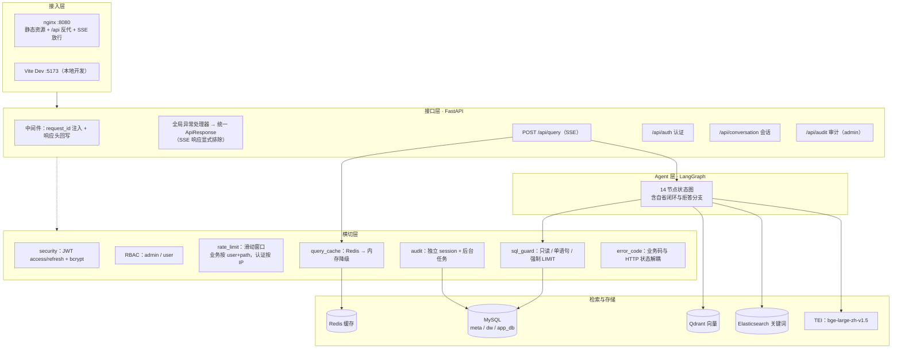
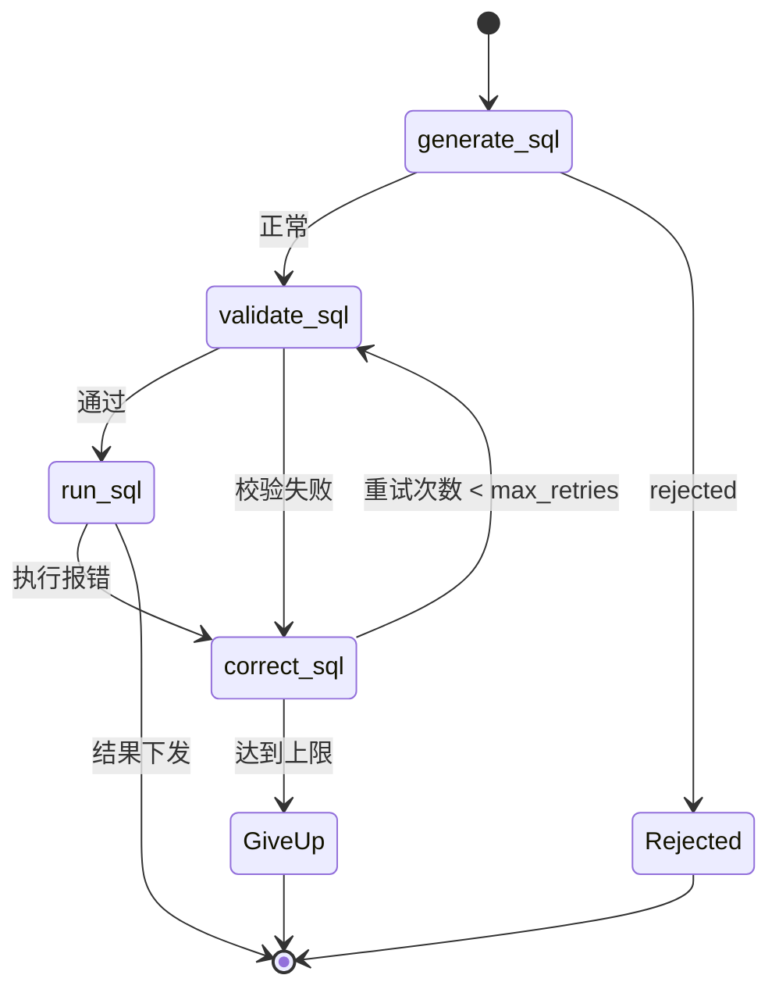
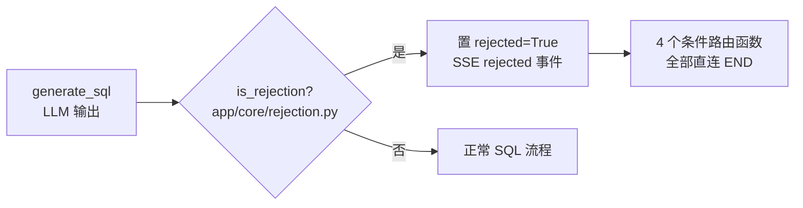
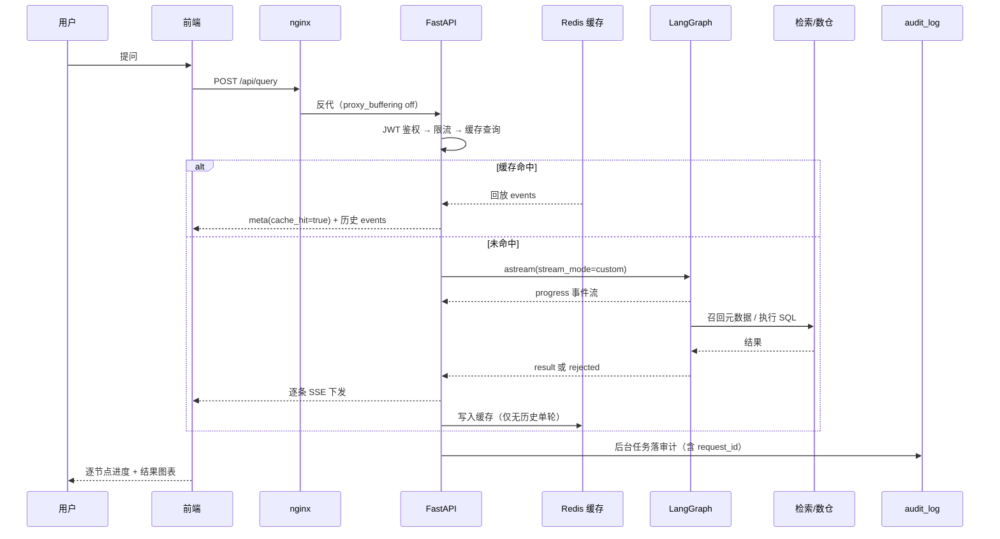
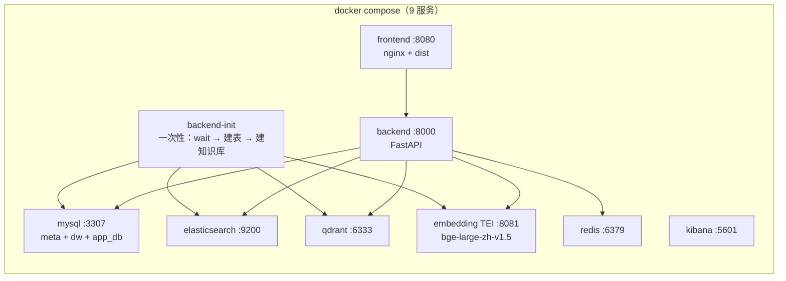

# NL2SQL 智能问数系统 · 架构说明

> 面向"读代码的人"和"答辩时被追问的人"。本文解释**每个模块为什么这样设计**，
> 而不是重复代码。配套阅读：[`data-agent/README.md`](../data-agent/README.md)。

---

## 一、分层架构



**为什么分横切层**：限流、缓存、审计、安全网关都是"与问数业务无关、但每个接口都要"的能力。
把它们放在 `app/core/` 而不是塞进路由函数，是为了让 Agent 图保持纯粹——
`app/agent/` 下没有任何一行代码知道 JWT、Redis 或 HTTP 状态码。

---

## 二、Agent 状态图：14 节点逐一看

状态图入口 `app/agent/graph.py`，节点实现 `app/agent/nodes/`。**`rewrite_query` 是 START**——
先把"人话"补全成"可独立理解的问题"，再谈检索与生成。

| # | 节点 | 做什么 | 是否调 LLM | 关键设计 |
|---|---|---|---|---|
| 1 | `rewrite_query` | 结合历史消解指代/省略 | 是（有历史时） | **无历史时直接返回原问题**，不做无谓调用；异常回退原问题，不中断整图 |
| 2 | `extract_keywords` | 抽取检索关键词 | **否** | jieba 按词性过滤（名词/地名/动词/形容词…），零延迟零成本 |
| 3 | `recall_column` | 字段召回（向量 + 关键词） | 否 | 双路并行：Qdrant 相似度 + ES BM25 |
| 4 | `recall_value` | 取值召回（如"华东""铂金"） | 否 | 让"值"也能被检索到，解决枚举值匹配 |
| 5 | `recall_metric` | 指标召回（GMV / AOV） | 否 | 命中指标才能注入口径 |
| 6 | `fuse_recall` | **RRF 融合** | 否 | `score = Σ 1/(k + rank)`，k=60，同分保持首次出现顺序 |
| 7 | `merge_retrieved_info` | 汇总召回明细、拼装表结构 | 否 | 输出 `table_infos` 供后续过滤 |
| 8 | `filter_table` | LLM 过滤无关表 | 是 | 控制 prompt 体积，避免把 5 张表全塞进去 |
| 9 | `filter_metric` | LLM 过滤无关指标 | 是 | 与 8 并行（图中同源于 merge） |
| 10 | `add_extra_context` | 注入**指标口径** + **few-shot** | 否（检索） | 分档字符预算：口径 > few-shot > 召回明细 |
| 11 | `generate_sql` | 生成 SQL / 判定越界 | 是 | 输出 `NO_ANSWER` 即置 `rejected`；可选开启自洽投票 |
| 12 | `validate_sql` | 安全网关校验 + EXPLAIN 预检 | 否 | 两道防线：静态策略 + 数据库侧语法校验 |
| 13 | `correct_sql` | 带报错信息重写 SQL | 是 | 用 `llm_code`（与主模型解耦），带 `error_history` |
| 14 | `run_sql` | 在 dw 库执行并下发结果 | 否 | 执行受 `sql_guard` 的超时/行数/字节限制 |

> 注：上表 14 项与 `graph.py` 中 `add_node` 的 14 次调用一一对应。
> 其中 `validate_sql → correct_sql → validate_sql` 构成自省回路，`run_sql` 报错同样回退到 `correct_sql`，
> 因此节点虽只有 14 个，实际执行路径会因重试次数不同而变化（4 组条件边）。

### 2.1 自省纠错闭环



- 状态字段：`sql_attempts[]`（每次尝试的 SQL / stage / error）、`error_history[]`、`attempt_count`
- **为什么这个闭环有效**：LLM 生成 SQL 的典型失败是"字段名写错 / JOIN 条件漏了 / 聚合与分组不匹配"，
  而这些错误 MySQL 的报错信息（`Unknown column 'xxx'`）本身就是最好的纠错提示。
  把报错原文回喂给模型，比单纯重试采样有效得多。
- 代价：每次纠错一轮完整 LLM 调用（实测平均尝试次数 2.0，即多数查询经历"生成 + 校验/执行"两次落库记录）

### 2.2 数据范围边界与拒答机制

**问题**：问"预测下个月能卖多少钱"，模型不会说"我不会"，而是编一个看起来合理的 SQL。
在问数场景里，"编造的正确数字"比"报错"危险得多。

**方案**：让"拒答"成为协议里的一等公民，而不是靠 prompt 里一句"不知道就说不知道"。



四层拦截，任何一层漏判都有下一层兜底：

| 层 | 位置 | 作用 |
|---|---|---|
| 1 | `generate_sql` | 主判定：输出 `NO_ANSWER` 即置 `rejected` |
| 2 | `graph.route_after_generate` | 拒答直接 END，**不进入校验与执行** |
| 3 | `validate_sql` | 兜底：上游漏判时在此拦截，跳过安全校验 |
| 4 | `route_after_validate` / `route_after_correct` | 纠错过程中若再次判越界，立即终止 |

`is_rejection()` 的稳健性处理（真实踩过的坑）：

- 容忍前后空白 / 换行
- 剥掉 Markdown 代码块围栏（模型爱用 ```sql 包裹）
- **宽松兜底**：首行为标记**且**整体不含 `SELECT` 才判拒答，避免把含该词的正常 SQL 误杀

实测：**拒答准确率 90%、误拒答率 0%**。

---

## 三、召回与融合

### 3.1 为什么双路

| 路 | 优势 | 短板 |
|---|---|---|
| 向量（Qdrant + bge-large-zh-v1.5） | 语义近义词可召回（"卖了多少" ↔ `order_amount`） | 对精确枚举值（"铂金会员"）不敏感 |
| 关键词（Elasticsearch + BM25） | 精确匹配强，中文分词可控 | 同义改写命中不了 |

两路都召回 `recall_top_k=20`，再 RRF 融合取 `fuse_top_n=10`。

### 3.2 RRF 公式

```
score(item) = Σ_over_lists  1 / (k + rank_i)     k = 60
```

选 RRF 而不是"分数加权求和"的理由：**不需要归一化**。向量相似度是 [0,1] 的余弦，
ES 的 BM25 是无上界的相关性分，两者量纲不可比；RRF 只用名次，天然免疫量纲问题。

> ⚠️ **诚实结论**：当前元数据仅 5 表 / 2 指标，每路候选 < 20 条，`fuse_top_n=10` 截断后
> 两路结果高度重叠，因此 RRF 相对"并集去重"的增益有限（EX 持平，字段召回 84.4% → 87.2%，+2.8pp）。
> 这是**元数据规模的限制**，不是 RRF 无效（`evaluation` 附带的 k 扫描显示 k∈[1,100] 实体排名不变）。

---

## 四、SSE 流式协议

问数接口 `POST /api/query` 返回 `text/event-stream`，前端逐事件渲染进度。

| 事件类型 | 时机 | payload 关键字段 |
|---|---|---|
| `meta` | 首个事件 | `conversation_id`、`cache_hit` |
| `progress` | 每个节点起止 | `step`（改写/提取关键词/召回字段/生成SQL/验证SQL/执行SQL）、`status` |
| `security` | 安全网关拒绝 | `status=rejected`、`reason` |
| `self_consistency` | 自洽投票开启时 | 候选与投票结果 |
| `rejected` | 判定越界 | `reason=out_of_scope`、`message`（面向用户话术） |
| `result` | 执行成功 | SQL、结果数据 |
| `error` | 异常 | `message` |



> **nginx 必须放行流式**：默认 `proxy_buffering on` 会把 SSE 攒到最后一次性下发，
> 前端进度条形同虚设。`data-agent-fronted/nginx.conf` 已配置
> `proxy_buffering off; gzip off; proxy_read_timeout 3600s;`。

---

## 五、工程化模块的设计权衡

| 模块 | 决策 | 备选方案 | 为什么这样选 | 代价 / 已知局限 |
|---|---|---|---|---|
| 认证 | 无状态 JWT（access 15min + refresh 7d） | Session + Redis | 服务不保存会话态，天然支持多副本水平扩容 | 无法主动吊销 token（靠短有效期缓解） |
| 限流 | 内存滑动窗口（`user_id + path`） | Redis 令牌桶 | 零额外依赖、零网络往返 | 多副本各自计数、重启清零；生产应换 Redis，`is_allowed()` 语义不变可无缝替换 |
| 缓存 | Redis 优先，失败降级进程内 TTL | 纯 Redis | Redis 挂了问数仍可用（可用性优先） | 降级后各进程缓存不共享 |
| 缓存键 | `问题 + 数据范围`，**带历史一律不命中** | 按会话缓存 | 防跨会话污染（同一问题在不同上下文答案不同） | 多轮场景享受不到缓存 |
| 审计 | 独立 session + 后台任务 fire-and-forget | 主流程同步写 | 审计失败不能拖垮问数 | 极端情况下可能丢少量审计记录 |
| 错误码 | 业务码与 HTTP 状态解耦（40101 / 40301 / 42900） | 直接用 HTTP 状态 | 一个 HTTP 状态可对应多种业务原因（401 下有"无令牌/令牌无效/令牌类型错"） | 前端需按 code 分支而非 status |
| 安全网关 | 黑名单 + 强制 LIMIT + EXPLAIN 预检 | 白名单 schema 限定 | 兼顾灵活性与安全，且 EXPLAIN 能捕获字段不存在等数据库侧错误 | 黑名单理论上可被绕过，生产建议叠加只读账号 |
| 对象存储连接 | 全部 Env 化（`${oc.env:VAR,default}`） | 硬编码 / 多套配置文件 | 公益网关模型两次被下架，换模型必须零改动 | 无 |
| uvicorn | `--workers 1` | 多 worker | SSE 流式与内存降级缓存依赖单进程状态 | 扩容靠多容器 + 共享 Redis，而非加 worker |

---

## 六、部署拓扑



启动顺序由 `depends_on` + `condition: service_completed_successfully`（init 容器）保证，
不靠 sleep 猜时间。`wait_for_deps.py` 用 TCP 探活兜底——qdrant 镜像内没有 curl/wget，
做不了 HTTP healthcheck。

> Embedding 权重 1.3 GB 不进仓库（`.gitignore` 排除），首次需单独下载；
> CPU 模式下 TEI 加载约 5~6 分钟，`wait_for_deps` 最长等 600s。

---

## 七、代码地图（被追问时能秒定位）

| 想知道 | 看哪里 |
|---|---|
| Agent 怎么串起来的 | `app/agent/graph.py` |
| 每个节点在做什么 | `app/agent/nodes/*.py`（文件名即节点名） |
| 拒答怎么判的 | `app/core/rejection.py` + `nodes/generate_sql.py` |
| SQL 为什么被拦 | `app/core/sql_guard.py` + `nodes/validate_sql.py` |
| 指标口径 / few-shot 怎么注入 | `app/agent/context_enhancer.py` + `conf/few_shot_examples.yaml` |
| 自洽投票 | `app/agent/self_consistency.py` |
| SSE 怎么发的 | `app/services/query_service.py` |
| 错误码清单 | `app/core/error_code.py` |
| 限流 / 缓存 | `app/core/rate_limit.py` / `app/core/query_cache.py` |
| 所有可调参数 | `conf/app_config.yaml`（带注释说明取舍） |
| 评测怎么算的 | `scripts/run_evaluation.py` / `scripts/run_ablation.py` |
